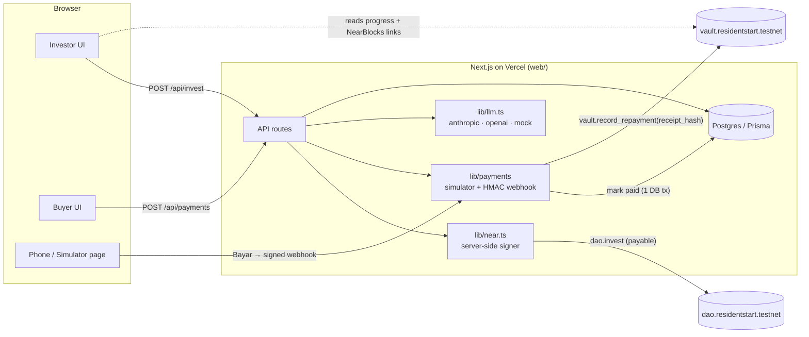

# Residentstart — property crowdfunding on NEAR

**Live demo:** https://residentstart.biz.id · **Built at NEAR HACKATHON 2026** · testnet only · MIT

Residentstart is a Jakarta property developer that funds its own housing projects through a DAO on NEAR. Investors deposit NEAR (testnet) and receive shares in a project; share holders vote to approve funding. Home buyers pay in **rupiah** — cash or a 5/10/15-year installment financed by the DAO pool — and **every paid installment leaves a receipt hash on-chain**, so investors can watch the money come back. A 360° room-by-room tour, AI agents for investors and buyers, and three simulated SEO marketing agents complete the experience.

The site is a **buyer-facing property portal** (photo hero, search, Pinhome-style cards with `Rp 2,85 Miliar`, KT/KM/LT/LB and installment lines) with separate **For Buyer**, **For Investor** and **Blog** sections, five projects, and a **13-stop photo walkthrough** of the real show unit.

The demo proves three things:

1. **Money goes in on-chain** — an investor invests NEAR testnet, receives shares, and the transaction is on NearBlocks.
2. **Money comes back on-chain** — a buyer pays a (simulated) rupiah installment and within seconds `vault.record_repayment` writes the receipt hash; the investor dashboard shows repayment progress.
3. **The house is real enough to want** — real show-unit photos, a phone-friendly photo walkthrough (arrows, thumbnails, floor-plan minimap), a pricing table per tenor, and agents that answer from project data only.

## Pages

| Route | What |
| --- | --- |
| `/` | Buyer portal: photo hero + search (location, price band, bedrooms; client-side), location chips, homes grid, why/how, location tiles, demo testimonials, blog teaser |
| `/buy`, `/buy/[slug]`, `/buy/[slug]/tour` | Homes ready to buy (funded / in construction / completed): filters, detail page (gallery + lightbox, specs, installment tabs, floor plans, location, similar homes), photo walkthrough |
| `/invest`, `/invest/[slug]`, `/invest/[slug]/tour` | Projects open for funding: live on-chain shares, DAO explainer, investor login, funding card, "show-unit preview" tour |
| `/blog`, `/blog/[slug]` | Six articles (buying, investing, market, financing) |
| `/login?role=investor\|buyer`, `/signup` | Role tabs; demo accounts per role |
| `/investor`, `/buyer`, `/admin`, `/pay/[id]`, `/simulator/[id]` | Dashboards, payment and simulator (unchanged flow; investor has a project selector) |
| `/project/[slug]` | 301 → `/buy/[slug]` or `/invest/[slug]` by audience |

Audience is computed from status: `funding` → For Investor; `funded`, `in_construction`, `completed` → For Buyer. When the DAO approves a funding project it moves to For Buyer automatically.

## Projects (seed)

| Project | Area | Status | Price / target | KT · KM · LT · LB |
| --- | --- | --- | --- | --- |
| Cilandak Residence | Cilandak, Jakarta Selatan | funded | Rp 2.850.000.000 | 3 · 2 · 72 · 90 |
| Jagakarsa Townhouse | Jagakarsa, Jakarta Selatan | completed | Rp 1.950.000.000 | 3 · 2 · 90 · 110 |
| Cipete Garden Home | Cipete, Jakarta Selatan | in construction | Rp 3.600.000.000 | 4 · 3 · 150 · 180 |
| Bintaro Green Cluster | Pondok Aren, Tangerang Selatan | funding | 300 shares × 10 NEAR | 3 · 2 · 105 · 130 |
| Depok Hills Cluster | Cimanggis, Depok | funding | 250 shares × 10 NEAR | 3 · 2 · 84 · 100 |

Specs, nearby places and distances are demo values. The four non-Cilandak projects use the Cilandak show unit (same unit type) as photo and tour reference. All image sources: [`docs/credits.md`](docs/credits.md).

## Tour v2

Pannellum 2.5.6 with **partial panoramas**: each normal show-unit photo is projected at its camera field of view (`haov`/`vaov`), so dragging looks around inside the shot with correct perspective; green arrows (back arrows point down) walk room to room; a thumbnail strip and a floor-plan minimap (ground/upper floor tabs, clickable pins) follow the current stop; fullscreen; `?debug=1` prints yaw/pitch on click. Config: `web/public/tours/cilandak-residence-walkthrough/rooms.json`, stored in the `tour_sets` table. Upgrading a stop to full 360° = a 2:1 equirectangular file with `haov 360 / vaov 180`, no code change.

> **DEMO — NEAR testnet, synthetic data, no real money. MODE SIMULASI — jangan transfer uang sungguhan.** Nothing here is an offer to invest or a real sale.

---

## Architecture



**Money in:** Invest form → `POST /api/invest` → session check → balance & remaining-shares pre-check → `lib/near.ts` signs `dao.invest` with the deposit (remainder refunded in the same call) → `investments` row with tx hash → `get_holding`.

**Money back:** Pay page → `POST /api/payments` (amount from the schedule, never the client) → simulator "Bayar" → HMAC-signed `POST /api/payments/webhook` → verify signature, dedupe `event_id`, check amount → payment + period marked paid in one DB transaction → `receipt_hash = sha256(loan_id|period|amount|paid_at)` → `vault.record_repayment` signed by the admin key → `repayment_receipts.tx_hash`. If the NEAR call fails the payment stays paid and is retried on the next status poll (and via the admin "Retry receipt" button).

| Path | What |
| --- | --- |
| `contracts/dao` | Rust (near-sdk 5): projects, shares, `invest` (payable, refund remainder), proposals, share-weighted votes, finalize |
| `contracts/vault` | Rust: loans and repayment receipts (`record_repayment` rejects duplicates / out-of-range periods) |
| `web/` | Next.js 15 App Router + Tailwind + Prisma (Postgres) — all pages, API routes, server signer |
| `prompts/` | Runtime prompts sent to the LLM (guardrails + 3 agents); `web/prompts` is the deployed copy |
| `web/data/knowledge` | Static agent knowledge; `web/data/mock-answers.json` for `LLM_PROVIDER=mock` |
| `web/content/blog` | Blog articles (markdown + frontmatter), imported by the seed |
| `docs/` | PRD, PRD-2, demo script, submission text, NEAR notes, image credits, build log |

## Deployed contracts (NEAR testnet)

| Contract | Account | Explorer |
| --- | --- | --- |
| DAO (shares, voting) | `dao.residentstart.testnet` | https://testnet.nearblocks.io/address/dao.residentstart.testnet |
| Vault (loans, receipts) | `vault.residentstart.testnet` | https://testnet.nearblocks.io/address/vault.residentstart.testnet |
| Owner / admin signer | `residentstart.testnet` | https://testnet.nearblocks.io/address/residentstart.testnet |

Example transactions from the QA run: invest `CriyAxCvC33Sug7kxkJUuSFGaRTsE37P1QHsk9Vh4tXK`, create loan `BWs6eMXhZtPECZmeeq3M82M8hFFfcm6qp878GtktcUso`, repayment receipt `ByypVeS49KraWaRJbR89aAmarVmpzbcGa9xraS9EHr9K` (open `https://testnet.nearblocks.io/txns/<hash>`).

## Quick start (local, ~10 minutes)

Prerequisites: Node 20+ and a Postgres database (a free Supabase project works; use its pooled URL for `DATABASE_URL` and the session/direct URL for `DIRECT_URL`).

```bash
git clone https://github.com/discoverateagency-ops/residentstart.git
cd residentstart/web
cp .env.example .env          # fill in DATABASE_URL, DIRECT_URL, secrets, NEAR keys (see below)
npm install
npx prisma migrate deploy
npm run seed                  # wipes and seeds the demo data (5 projects, tour set, 6 blog posts); creates the 2 funding projects on-chain when NEAR_ADMIN_KEY is set
npm run dev                   # http://localhost:3000
```

Every variable is documented in [`web/.env.example`](web/.env.example). `LLM_PROVIDER=mock` is the default, so no LLM key is needed.

**NEAR keys.** The hosted demo already holds testnet keys. To run your own copy, create testnet accounts (e.g. `near account create-account sponsor-by-faucet-service <name>.testnet ...`), deploy the contracts (see `contracts/*/README.md`), and put the owner and two investor keys in `.env`; `npm run seed` then creates the funding projects on-chain (or use admin → **DAO → Create project on-chain**).

Other scripts: `npm test` (unit tests: pricing, price formatting, search filters, VA/QR/expiry/HMAC/receipt hash), `npx tsx --env-file=.env scripts/e2e.ts` (108 end-to-end checks against a freshly seeded running app, spends ~45 testnet NEAR), `npx tsx --env-file=.env scripts/near-topup.ts 40` (recycles invested testnet NEAR back to the demo investors), `cd contracts/dao && cargo test`.

## Demo accounts

| Role | Email | Password |
| --- | --- | --- |
| Admin | `admin@residentstart.demo` | `Residentstart2026!` |
| Investor | `investor1@residentstart.demo` | `Residentstart2026!` |
| Investor | `investor2@residentstart.demo` | `Residentstart2026!` |
| Buyer | `buyer1@residentstart.demo` | `Residentstart2026!` |

These are throwaway demo logins for a testnet app with synthetic data.

## 3-minute demo script

See [`docs/phase1-demo.md`](docs/phase1-demo.md). Short version: landing (search "Cipete", > 3 M) → home detail → photo walkthrough → **For Investor** → investor login → invest 10 NEAR in Bintaro (tx on NearBlocks) → admin opens the funding proposal → investors vote → admin finalizes → Bintaro moves to **For Buyer** → buyer1 verifies → confirms a 10-year installment on Cilandak (loan on-chain) → pays period 1 with QRIS from a phone (**Bayar**) → receipt hash on NearBlocks → investor dashboard shows 1/120 paid → **Blog**.

## What is simulated

- **Rupiah payments** — Virtual Accounts (BCA, BNI, Mandiri; numbers start with `9999`, tagged SIMULASI) and QRIS (encodes a link to the simulator page, never a real QRIS payload). A simulator page plays the bank and sends HMAC-signed webhooks.
- **Face verification** — browser-only demo with face-api.js (tiny face detector + landmarks + recognition models served from `web/public/models`, from `@vladmandic/face-api`). Only the reference photo and a 128-number descriptor are stored; live camera frames never leave the device. **Not KYC.** Admin override exists.
- **Marketing agents** — produce simulated weekly SEO reports; nothing is crawled or posted; metrics carry `note: "simulated"`.
- **Photos and plans** — show-unit photos are real (team's own); the other four projects reuse them as a reference for the same unit type. Floor plans, specs, nearby places, distances and maps are illustrative. Testimonials are marked "demo testimonial".
- **Money** — NEAR testnet only; testnet NEAR has no value. Investor accounts are server-signed demo accounts.

## Going to production

User-held wallets via NEAR Wallet Selector (no server-held investor keys) · admin actions behind a multisig or MPC signer · a licensed KYC provider instead of the browser demo · a real payment gateway behind the existing `PaymentProvider` interface · default/recovery terms written into the funding proposal · legal structure under Indonesia's OJK securities-crowdfunding rules, reviewed by a lawyer (this README is not legal advice).

## Security notes

All keys live in server environment variables; nothing in the client bundle (checked: no `ed25519:` or API-key strings in `.next/static`). Webhooks are HMAC-SHA256 verified with constant-time compare, deduplicated by `event_id`, and amount-checked against the schedule. Known transitive advisories (`elliptic` via near-api-js — only ed25519 is used; `sharp` — image optimisation disabled; Prisma CLI internals) do not affect the runtime paths used here.

## Disclosure

- Code written during the hackathon (Nov 2026). AI use: built with Claude Code (Anthropic); the in-app agents call an LLM (Anthropic Claude by default, or OpenAI) or run in mock mode.
- Pre-existing material: the PRD, brand concept, runtime prompts, agent knowledge files and synthetic panoramas were prepared by the team for this project.
- Built by the same team as **SentFund** (https://sentfund.my.id), submitted separately.

## Tracks, team, license

Tracks: Real-World Money · Social Money · Open Innovation. Team: Septianus Angga Wicaksono (CEO), Nindar Feriko (COO), and tech teammate. License: [MIT](LICENSE).
